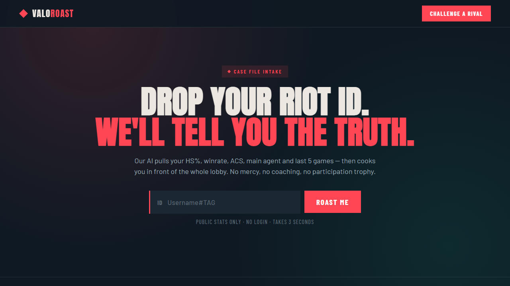

<p align="center">
  
</p>

# Valoroast

Valoroast turns a Valorant player's stats into a joke verdict. Enter a Riot ID, and the app pulls recent match data, then writes a short, exaggerated roast you can send to the friend who keeps dying first on site.

It started as a side project to roast my Valorant friends. It makes no attempt at serious analysis. The point is a laugh and a link to share.

## What you can do

- **Roast a player.** Type a Riot ID and get a verdict written from their agents, K/D, headshot rate and habits.
- **Share the result.** Every roast is saved and gets a share link, and you can download the verdict as a card to send to the person you just roasted.
- **Start a rivalry.** Put two players against each other and let the app decide who is the bigger disappointment.

## Tech stack

| Area | Tools |
| --- | --- |
| Framework | Next.js 16 (App Router), React 19, TypeScript |
| Styling | Tailwind CSS v4, Radix UI, Tailwind Variants |
| Roast text | Vercel AI SDK with OpenAI (`gpt-4o-mini` by default) |
| Player data | HenrikDev API, an unofficial Valorant API |
| Database | Neon Postgres with Drizzle ORM |
| Client state | TanStack Query, Zustand, React Hook Form, Zod |
| Abuse protection | `rate-limiter-flexible`, per IP and for HenrikDev calls |
| Tooling | Biome, Docker |

The app logic lives in Next.js route handlers under `src/app/api`, so the OpenAI and HenrikDev keys never reach the browser. Roasts are stored in Neon so each one can be opened again from its link. Rate limits keep the OpenAI bill and the HenrikDev quota under control.

## Running it locally

```bash
npm install
cp .env.example .env.local   # add OPENAI_API_KEY, HENRIKDEV_API_KEY and DATABASE_URL
npm run db:migrate
npm run dev
```

The app runs at http://localhost:3000. A `Dockerfile` is included for deployment.

## Disclaimer

Valoroast isn't endorsed by Riot Games and doesn't reflect the views of Riot Games or anyone officially involved in producing or managing Riot Games properties. Player data comes from an unofficial third-party API and may break.
